# Лабораторная работа №2: Изучение HTTP-методов и реализация CRUD-операций

**Студент:** Алейникова Юлия Андреевна  
**Группа:** ПИЖ-б-о-25-1  
**Вариант:** 4 (средний уровень)  
**Сущность:** Книги (books)  
**Технология:** Node.js + Express + Postman

## Содержание

1. Цель работы
2. Теоретическое обоснование
3. Выполнение практического примера
4. Выполнение индивидуального задания
5. Контрольные вопросы
6. Вывод
7. Список использованных источников

## Цель работы

Освоить обработку различных HTTP-методов (GET, POST, PUT, DELETE) в Express. Научиться реализовывать CRUD-операции над коллекцией объектов, хранящейся в памяти сервера, а также возвращать корректные HTTP-коды ответов (200, 201, 204, 400, 404).

## Теоретическое обоснование

CRUD – это акроним, обозначающий четыре базовые операции над данными:

| Операция | Расшифровка | HTTP-метод | SQL-аналог |
|----------|-------------|------------|------------|
| Create   | Создание    | POST       | INSERT     |
| Read     | Чтение      | GET        | SELECT     |
| Update   | Обновление  | PUT / PATCH| UPDATE     |
| Delete   | Удаление    | DELETE     | DELETE     |

### HTTP-методы

- **GET** – получение данных. Тело запроса отсутствует. Идемпотентен и безопасен. Коды ответов: `200 OK`, `404 Not Found`.
- **POST** – создание нового ресурса. Тело содержит данные нового ресурса. Не идемпотентен. Коды ответов: `201 Created`, `400 Bad Request`.
- **PUT** – полное обновление ресурса. Тело содержит новые данные. Идемпотентен. Коды ответов: `200 OK`, `404 Not Found`.
- **DELETE** – удаление ресурса. Тело запроса отсутствует. Идемпотентен. Коды ответов: `200 OK`, `204 No Content`, `404 Not Found`.

### Коды состояния HTTP

| Код | Название               | Когда используется                          |
|-----|------------------------|---------------------------------------------|
| 200 | OK                     | Успешный GET, PUT, DELETE                   |
| 201 | Created                | Успешный POST (ресурс создан)               |
| 204 | No Content             | Успешный DELETE (нет тела ответа)           |
| 400 | Bad Request            | Ошибка в данных запроса                     |
| 404 | Not Found              | Ресурс не найден                            |
| 500 | Internal Server Error  | Ошибка на сервере                           |

### Хранение данных в памяти

В данной работе база данных не используется – данные хранятся в массиве в оперативной памяти сервера.

**Преимущества:** простота, не нужна установка БД, быстрый доступ.

**Недостатки:** данные теряются при перезапуске сервера, не подходит для production.

Пример хранения:

```javascript
let items = [
  { id: 1, name: 'Товар 1', price: 100 },
  { id: 2, name: 'Товар 2', price: 200 }
];
```

## Выполнение практического примера

### Шаг 1. Подготовка проекта

```bash
mkdir lab2-crud
cd lab2-crud
npm init -y
npm install express
npm install --save-dev nodemon
```

### Шаг 2. Настройка package.json

```json
"scripts": {
  "start": "node app.js",
  "dev": "nodemon app.js"
}
```

### Шаг 3. Код сервера (app.js)

```javascript
const express = require('express');
const app = express();
const port = 3000;

// Middleware для парсинга JSON из тела запроса
app.use(express.json());

// Middleware для логирования запросов
app.use((req, res, next) => {
  console.log(`[${new Date().toISOString()}] ${req.method} ${req.url}`);
  next();
});

// ============ ХРАНИЛИЩЕ ДАННЫХ В ПАМЯТИ ============
let items = [
  { id: 1, name: 'Товар 1', price: 100, quantity: 5 },
  { id: 2, name: 'Товар 2', price: 200, quantity: 3 },
  { id: 3, name: 'Товар 3', price: 300, quantity: 10 }
];

let nextId = 4;

// ============ CRUD-ОПЕРАЦИИ ============

// GET /items – получить все элементы
app.get('/items', (req, res) => {
  res.json({ count: items.length, items: items });
});

// GET /items/:id – получить один элемент
app.get('/items/:id', (req, res) => {
  const id = parseInt(req.params.id);
  const item = items.find(i => i.id === id);
  if (!item) {
    return res.status(404).json({ error: 'Элемент не найден' });
  }
  res.json(item);
});

// POST /items – создать новый элемент
app.post('/items', (req, res) => {
  const { name, price, quantity } = req.body;
  if (!name || price === undefined) {
    return res.status(400).json({ error: 'Поля name и price обязательны' });
  }
  const newItem = { id: nextId++, name, price, quantity: quantity || 0 };
  items.push(newItem);
  res.status(201).json(newItem);
});

// PUT /items/:id – обновить элемент
app.put('/items/:id', (req, res) => {
  const id = parseInt(req.params.id);
  const index = items.findIndex(i => i.id === id);
  if (index === -1) {
    return res.status(404).json({ error: 'Элемент не найден' });
  }
  const { name, price, quantity } = req.body;
  items[index] = {
    id: id,
    name: name || items[index].name,
    price: price !== undefined ? price : items[index].price,
    quantity: quantity !== undefined ? quantity : items[index].quantity
  };
  res.json(items[index]);
});

// DELETE /items/:id – удалить элемент
app.delete('/items/:id', (req, res) => {
  const id = parseInt(req.params.id);
  const index = items.findIndex(i => i.id === id);
  if (index === -1) {
    return res.status(404).json({ error: 'Элемент не найден' });
  }
  const deletedItem = items.splice(index, 1)[0];
  res.json({ message: 'Элемент удалён', deleted: deletedItem });
});

// Обработка 404
app.use((req, res) => {
  res.status(404).json({ error: 'Маршрут не найден' });
});

app.listen(port, () => {
  console.log(`Сервер запущен на http://localhost:${port}`);
});
```

### Шаг 4. Запуск сервера

```bash
npm run dev
```

### Шаг 5. Проверка работы

**GET – получить все элементы:** `http://localhost:3000/items`

```json
{
  "count": 3,
  "items": [
    { "id": 1, "name": "Товар 1", "price": 100, "quantity": 5 },
    { "id": 2, "name": "Товар 2", "price": 200, "quantity": 3 },
    { "id": 3, "name": "Товар 3", "price": 300, "quantity": 10 }
  ]
}
```

**GET – получить один элемент:** `http://localhost:3000/items/2`

```json
{ "id": 2, "name": "Товар 2", "price": 200, "quantity": 3 }
```

**POST – создать элемент:** `http://localhost:3000/items`

```json
{ "name": "Новый товар", "price": 500, "quantity": 7 }
```

Ответ (201 Created):

```json
{ "id": 4, "name": "Новый товар", "price": 500, "quantity": 7 }
```

**PUT – обновить элемент:** `http://localhost:3000/items/1`

```json
{ "name": "Обновлённый товар", "price": 150, "quantity": 20 }
```

Ответ (200 OK):

```json
{ "id": 1, "name": "Обновлённый товар", "price": 150, "quantity": 20 }
```

**DELETE – удалить элемент:** `http://localhost:3000/items/3`

Ответ (200 OK):

```json
{
  "message": "Элемент удалён",
  "deleted": { "id": 3, "name": "Товар 3", "price": 300, "quantity": 10 }
}
```

## Выполнение индивидуального задания

**Вариант 4 (средний уровень). Сущность: Книги (books).**

Поля: `id`, `title`, `year`, `genre`, `author`.

### Требования среднего уровня

1. Валидация входных данных (400 Bad Request): проверка обязательных полей, проверка типов.
2. Дополнительные эндпоинты:
   - `GET /books?search=...` – поиск по названию;
   - `GET /books?sort=field&order=asc|desc` – сортировка;
   - `GET /books?page=1&limit=10` – пагинация.
3. Правильные коды ответов: `201` при POST, `204` при DELETE, `400` при неверных данных.

### Структура проекта

```text
lab2-books/
├── app.js
├── package.json
├── package-lock.json
└── README.md
```

### Код сервера (app.js)

```javascript
const express = require('express');
const app = express();
const port = 3000;

app.use(express.json());

app.use((req, res, next) => {
  console.log(`[${new Date().toISOString()}] ${req.method} ${req.url}`);
  next();
});

// ============ ХРАНИЛИЩЕ ДАННЫХ ============
let books = [
  { id: 1, title: 'Война и мир', year: 1869, genre: 'Роман', author: 'Лев Толстой' },
  { id: 2, title: 'Преступление и наказание', year: 1866, genre: 'Роман', author: 'Фёдор Достоевский' },
  { id: 3, title: 'Мастер и Маргарита', year: 1967, genre: 'Мистика', author: 'Михаил Булгаков' },
  { id: 4, title: '1984', year: 1949, genre: 'Антиутопия', author: 'Джордж Оруэлл' },
  { id: 5, title: 'Гарри Поттер и философский камень', year: 1997, genre: 'Фэнтези', author: 'Джоан Роулинг' }
];

let nextId = 6;

// ============ ВАЛИДАЦИЯ ============
function validateBook(body, isUpdate = false) {
  const errors = [];
  const { title, year, genre, author } = body;

  if (!isUpdate || title !== undefined) {
    if (!title || typeof title !== 'string' || title.trim() === '') {
      errors.push('Поле "title" обязательно и должно быть непустой строкой');
    }
  }
  if (!isUpdate || year !== undefined) {
    if (year === undefined || typeof year !== 'number' || isNaN(year)) {
      errors.push('Поле "year" обязательно и должно быть числом');
    }
  }
  if (!isUpdate || genre !== undefined) {
    if (!genre || typeof genre !== 'string' || genre.trim() === '') {
      errors.push('Поле "genre" обязательно и должно быть непустой строкой');
    }
  }
  if (!isUpdate || author !== undefined) {
    if (!author || typeof author !== 'string' || author.trim() === '') {
      errors.push('Поле "author" обязательно и должно быть непустой строкой');
    }
  }

  return errors;
}

// ============ CRUD ============

// GET /books – все книги (поиск, сортировка, пагинация)
app.get('/books', (req, res) => {
  let result = [...books];
  const { search, sort, order, page, limit } = req.query;

  // Поиск по названию
  if (search) {
    const s = search.toLowerCase();
    result = result.filter(b => b.title.toLowerCase().includes(s));
  }

  // Сортировка
  if (sort) {
    const sortOrder = order === 'desc' ? -1 : 1;
    if (result.length > 0 && result[0].hasOwnProperty(sort)) {
      result.sort((a, b) => {
        if (a[sort] < b[sort]) return -1 * sortOrder;
        if (a[sort] > b[sort]) return 1 * sortOrder;
        return 0;
      });
    } else {
      return res.status(400).json({ error: `Невозможно сортировать по полю "${sort}"` });
    }
  }

  // Пагинация
  const total = result.length;
  let pageNum = parseInt(page) || 1;
  let limitNum = parseInt(limit) || 10;
  if (pageNum < 1) pageNum = 1;
  if (limitNum < 1) limitNum = 10;

  const start = (pageNum - 1) * limitNum;
  const paginated = result.slice(start, start + limitNum);

  res.json({
    count: paginated.length,
    total: total,
    page: pageNum,
    limit: limitNum,
    books: paginated
  });
});

// GET /books/:id – одна книга
app.get('/books/:id', (req, res) => {
  const id = parseInt(req.params.id);
  const book = books.find(b => b.id === id);
  if (!book) return res.status(404).json({ error: 'Книга не найдена' });
  res.json(book);
});

// POST /books – создать книгу
app.post('/books', (req, res) => {
  const errors = validateBook(req.body, false);
  if (errors.length > 0) return res.status(400).json({ errors });

  const { title, year, genre, author } = req.body;
  const newBook = {
    id: nextId++,
    title: title.trim(),
    year: year,
    genre: genre.trim(),
    author: author.trim()
  };
  books.push(newBook);
  res.status(201).json(newBook);
});

// PUT /books/:id – обновить книгу
app.put('/books/:id', (req, res) => {
  const id = parseInt(req.params.id);
  const index = books.findIndex(b => b.id === id);
  if (index === -1) return res.status(404).json({ error: 'Книга не найдена' });

  const errors = validateBook(req.body, true);
  if (errors.length > 0) return res.status(400).json({ errors });

  const { title, year, genre, author } = req.body;
  books[index] = {
    id: id,
    title: title !== undefined ? title.trim() : books[index].title,
    year: year !== undefined ? year : books[index].year,
    genre: genre !== undefined ? genre.trim() : books[index].genre,
    author: author !== undefined ? author.trim() : books[index].author
  };
  res.json(books[index]);
});

// DELETE /books/:id – удалить книгу
app.delete('/books/:id', (req, res) => {
  const id = parseInt(req.params.id);
  const index = books.findIndex(b => b.id === id);
  if (index === -1) return res.status(404).json({ error: 'Книга не найдена' });

  books.splice(index, 1);
  res.status(204).send(); // 204 No Content
});

// 404
app.use((req, res) => {
  res.status(404).json({ error: 'Маршрут не найден' });
});

app.listen(port, () => {
  console.log(`Сервер запущен на http://localhost:${port}`);
});
```


### Настройка Postman

**Коллекция:** `Lab2 Books CRUD API`

**Окружение:** `Local Development` с переменной `base_url = http://localhost:3000`

**Структура коллекции:**

```text
Lab2 Books CRUD API
├── Books
│   ├── GET All Books          (GET {{base_url}}/books)
│   ├── GET Book by ID         (GET {{base_url}}/books/1)
│   ├── GET Books Search       (GET {{base_url}}/books?search=война)
│   ├── GET Books Sort         (GET {{base_url}}/books?sort=year&order=asc)
│   ├── Books with Pagination  (GET {{base_url}}/books?page=1&limit=2)
│   ├── Create Book            (POST {{base_url}}/books)
│   ├── Update Book            (PUT {{base_url}}/books/1)
│   └── Book                   (DELETE {{base_url}}/books/3)
└── Errors
    ├── GET Nonexistent Book (404)  (GET {{base_url}}/books/999)
    └── Invalid Data (400)          (POST {{base_url}}/books)
```

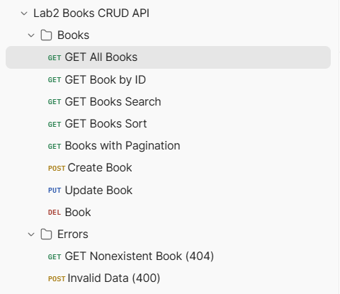


### Автоматические тесты

**Пример тестов для GET All Books:**

```javascript
pm.test("Статус 200 OK", function () {
    pm.response.to.have.status(200);
});

pm.test("Ответ в формате JSON", function () {
    pm.response.to.be.json;
});

pm.test("Есть поле count", function () {
    const jsonData = pm.response.json();
    pm.expect(jsonData).to.have.property('count');
});

pm.test("Есть поле books", function () {
    const jsonData = pm.response.json();
    pm.expect(jsonData).to.have.property('books');
    pm.expect(jsonData.books).to.be.an('array');
});
```

**Пример тестов для POST Create Book:**

```javascript
pm.test("Статус 201 Created", function () {
    pm.response.to.have.status(201);
});

pm.test("Ответ содержит ID", function () {
    const jsonData = pm.response.json();
    pm.expect(jsonData).to.have.property('id');
    pm.expect(jsonData.id).to.be.a('number');
});
```

**Пример тестов для DELETE Book:**

```javascript
pm.test("Статус 204 No Content", function () {
    pm.response.to.have.status(204);
});

pm.test("Тело ответа пустое", function () {
    pm.expect(pm.response.text()).to.be.empty;
});
```

**Пример тестов для GET Nonexistent Book (404):**

```javascript
pm.test("Статус 404 Not Found", function () {
    pm.response.to.have.status(404);
});

pm.test("Ответ содержит error", function () {
    const jsonData = pm.response.json();
    pm.expect(jsonData).to.have.property('error');
});
```


### Результаты Collection Runner

Запуск коллекции через Collection Runner показал следующие результаты:

| # | Запрос | Метод | Статус | Тесты |
|---|--------|-------|--------|-------|
| 1 | GET All Books | GET | 200 OK | 4 PASS |
| 2 | GET Book by ID | GET | 200 OK | 2 PASS |
| 3 | GET Books Search | GET | 200 OK | 5 PASS |
| 4 | GET Books Sort | GET | 200 OK | 4 PASS |
| 5 | Books with Pagination | GET | 200 OK | 6 PASS |
| 6 | Create Book | POST | 201 Created | 8 PASS |
| 7 | Update Book | PUT | 200 OK | 6 PASS |
| 8 | Book | DELETE | 204 No Content | 2 PASS |
| 9 | GET Nonexistent Book (404) | GET | 404 Not Found | 3 PASS |
| 10 | Invalid Data (400) | POST | 400 Bad Request | 5 PASS |

**Итого:** 45 тестов, 45 PASSED, 0 FAILED, 0 ERRORS.

**Общее время выполнения:** 1s 187ms.  
**Среднее время ответа:** 4 ms.

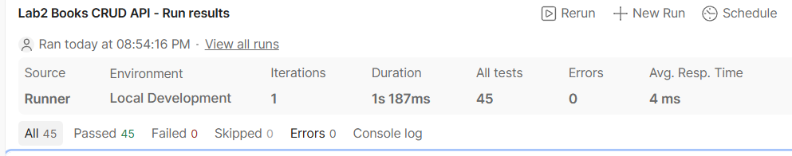

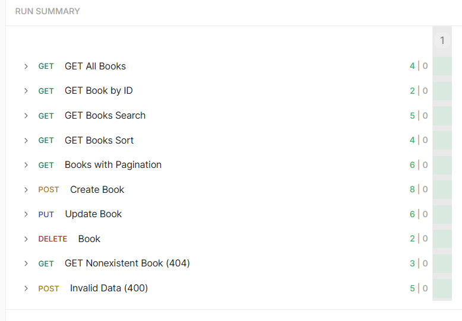

### Примеры ответов сервера

**GET All Books – GET `{{base_url}}/books`**

```json
{
  "count": 5,
  "total": 5,
  "page": 1,
  "limit": 10,
  "books": [
    { "id": 1, "title": "Война и мир", "year": 1869, "genre": "Роман", "author": "Лев Толстой" },
    { "id": 2, "title": "Преступление и наказание", "year": 1866, "genre": "Роман", "author": "Фёдор Достоевский" },
    { "id": 3, "title": "Мастер и Маргарита", "year": 1967, "genre": "Мистика", "author": "Михаил Булгаков" },
    { "id": 4, "title": "1984", "year": 1949, "genre": "Антиутопия", "author": "Джордж Оруэлл" },
    { "id": 5, "title": "Гарри Поттер и философский камень", "year": 1997, "genre": "Фэнтези", "author": "Джоан Роулинг" }
  ]
}
```
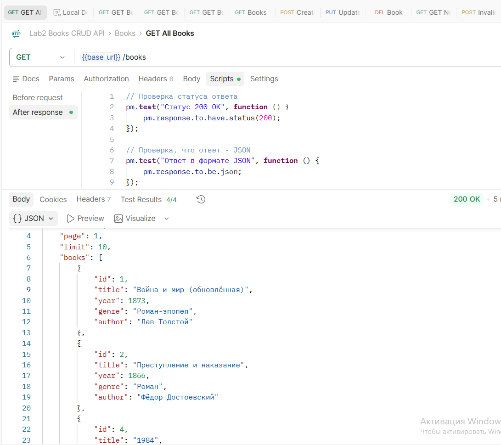

**GET Books Search – GET `{{base_url}}/books?search=война`**

```json
{
  "count": 1,
  "total": 1,
  "page": 1,
  "limit": 10,
  "books": [
    { "id": 1, "title": "Война и мир", "year": 1869, "genre": "Роман", "author": "Лев Толстой" }
  ]
}
```

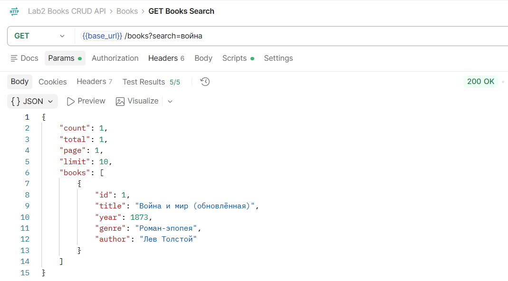

**GET Books Sort – GET `{{base_url}}/books?sort=year&order=asc`**

```json
{
  "count": 5,
  "total": 5,
  "page": 1,
  "limit": 10,
  "books": [
    { "id": 2, "title": "Преступление и наказание", "year": 1866, "genre": "Роман", "author": "Фёдор Достоевский" },
    { "id": 1, "title": "Война и мир", "year": 1869, "genre": "Роман", "author": "Лев Толстой" },
    { "id": 4, "title": "1984", "year": 1949, "genre": "Антиутопия", "author": "Джордж Оруэлл" },
    { "id": 3, "title": "Мастер и Маргарита", "year": 1967, "genre": "Мистика", "author": "Михаил Булгаков" },
    { "id": 5, "title": "Гарри Поттер и философский камень", "year": 1997, "genre": "Фэнтези", "author": "Джоан Роулинг" }
  ]
}
```

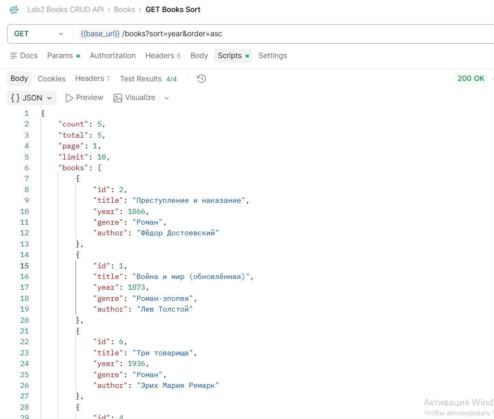

**Books with Pagination – GET `{{base_url}}/books?page=1&limit=2`**

```json
{
  "count": 2,
  "total": 5,
  "page": 1,
  "limit": 2,
  "books": [
    { "id": 1, "title": "Война и мир", "year": 1869, "genre": "Роман", "author": "Лев Толстой" },
    { "id": 2, "title": "Преступление и наказание", "year": 1866, "genre": "Роман", "author": "Фёдор Достоевский" }
  ]
}
```

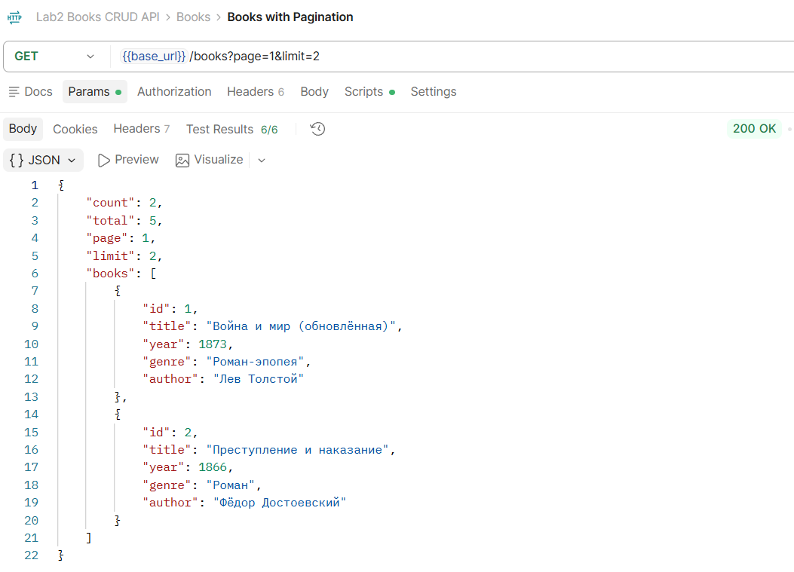

**Create Book – POST `{{base_url}}/books`**

Тело запроса:

```json
{
  "title": "Три товарища",
  "year": 1936,
  "genre": "Роман",
  "author": "Эрих Мария Ремарк"
}
```

Ответ (201 Created):

```json
{
  "id": 6,
  "title": "Три товарища",
  "year": 1936,
  "genre": "Роман",
  "author": "Эрих Мария Ремарк"
}
```

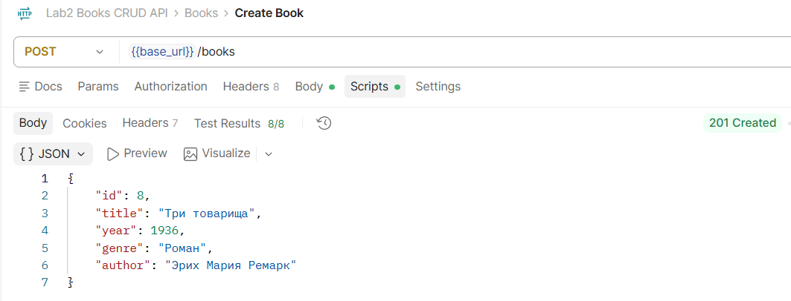

**Update Book – PUT `{{base_url}}/books/1`**

Тело запроса:

```json
{
  "title": "Война и мир (обновлённая)",
  "year": 1873,
  "genre": "Роман-эпопея",
  "author": "Лев Толстой"
}
```

Ответ (200 OK):

```json
{
  "id": 1,
  "title": "Война и мир (обновлённая)",
  "year": 1873,
  "genre": "Роман-эпопея",
  "author": "Лев Толстой"
}
```

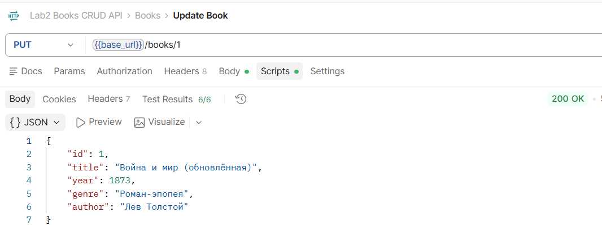

**Book (DELETE) – DELETE `{{base_url}}/books/3`**

Ответ (204 No Content): пустое тело.

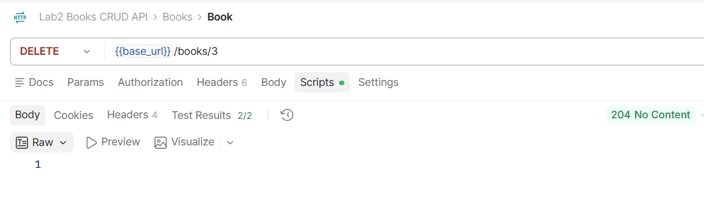

**GET Nonexistent Book (404) – GET `{{base_url}}/books/999`**

Ответ (404 Not Found):

```json
{
  "error": "Книга не найдена"
}
```

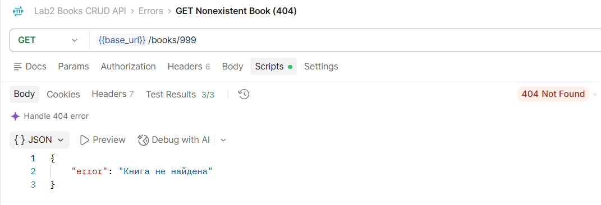

**Invalid Data (400) – POST `{{base_url}}/books`**

Тело запроса:

```json
{
  "title": "",
  "year": "не число",
  "genre": "",
  "author": ""
}
```

Ответ (400 Bad Request):

```json
{
  "errors": [
    "Поле \"title\" обязательно и должно быть непустой строкой",
    "Поле \"year\" обязательно и должно быть числом",
    "Поле \"genre\" обязательно и должно быть непустой строкой",
    "Поле \"author\" обязательно и должно быть непустой строкой"
  ]
}
```

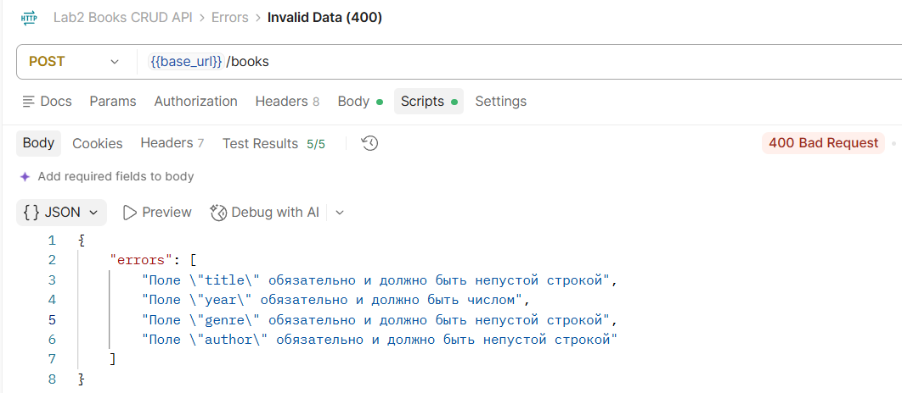

## Контрольные вопросы

1. **В чём разница между PUT и PATCH?**

   PUT – полное обновление ресурса: клиент передаёт все поля, и ресурс заменяется целиком. PATCH – частичное обновление: передаются только те поля, которые нужно изменить. PUT идемпотентен, PATCH тоже идемпотентен в корректной реализации, но семантически отличается.

2. **Как реализовать поиск по коллекции (query-параметр search)?**

   В Express читаем `req.query.search`, приводим к нижнему регистру и фильтруем массив:

   ```javascript
   if (search) {
     const s = search.toLowerCase();
     result = result.filter(item => item.title.toLowerCase().includes(s));
   }
   ```

3. **Как реализовать сортировку по полю?**

   Читаем `req.query.sort` и `req.query.order`, затем используем `Array.prototype.sort`:

   ```javascript
   const sortOrder = order === 'desc' ? -1 : 1;
   result.sort((a, b) => {
     if (a[sort] < b[sort]) return -1 * sortOrder;
     if (a[sort] > b[sort]) return 1 * sortOrder;
     return 0;
   });
   ```

4. **Как реализовать пагинацию (постраничный вывод)?**

   Читаем `page` и `limit`, вычисляем индексы и используем `slice`:

   ```javascript
   const start = (page - 1) * limit;
   const end = start + limit;
   const paginated = result.slice(start, end);
   ```

5. **Как валидировать входные данные (например, что price – число)?**

   Проверяем тип через `typeof` и наличие значения:

   ```javascript
   if (typeof year !== 'number' || isNaN(year)) {
     errors.push('Поле year должно быть числом');
   }
   ```

6. **Какие коды ответов используются при ошибках валидации?**

   `400 Bad Request` – если данные некорректны (не хватает обязательных полей, неверные типы).

7. **Как вернуть 204 No Content при DELETE?**

   Использовать `res.status(204).send()` – тело ответа не отправляется.

8. **В чём разница между res.json() и res.send()?**

   `res.json()` – устанавливает `Content-Type: application/json` и отправляет JSON. `res.send()` – универсальный метод: может отправлять строку, Buffer, объект (тогда тоже JSON, но без явной установки заголовка).

9. **Как избежать дублирования ID при создании новых элементов?**

   Использовать счётчик `nextId`, который увеличивается при каждом создании:

   ```javascript
   let nextId = 6;
   const newItem = { id: nextId++, ... };
   ```

10. **Что такое express.json() и почему без него req.body пустой?**

    `express.json()` – это встроенный middleware, который парсит тело запроса в формате JSON и кладёт результат в `req.body`. Без него `req.body` будет `undefined` или пустым объектом.

## Вывод

В ходе лабораторной работы я освоила обработку HTTP-методов (GET, POST, PUT, DELETE) в Express и реализовала CRUD API для сущности «Книги» с полями `id`, `title`, `year`, `genre`, `author`. Данные хранятся в памяти сервера. Реализованы все базовые операции, а также поиск, сортировка, пагинация и валидация входных данных.

Для тестирования использовался Postman: создана коллекция, окружение, написано 45 автотестов, все успешно пройдены через Collection Runner. Основная трудность – настройка тестов в новой версии Postman (вкладка Scripts → After response) и необходимость перезапуска сервера перед повторным запуском Collection Runner.

## Список использованных источников

1. Postman Learning Center – https://learning.postman.com/
2. Postman Documentation – https://documenter.getpostman.com/
3. Express – Routing – https://expressjs.com/en/guide/routing.html
4. Express – Request и Response – https://expressjs.com/en/4x/api.html
5. HTTP-методы (MDN) – https://developer.mozilla.org/ru/docs/Web/HTTP/Methods
6. Коды состояния HTTP (MDN) – https://developer.mozilla.org/ru/docs/Web/HTTP/Status
7. REST API Tutorial – https://restfulapi.net/
8. Thinder Client – https://www.thunderclient.com/
9. Методические указания к лабораторной работе №2.
10. Инструкция по настройке Postman для лаб2.