# Лабораторная работа №3: Маршрутизация, параметры пути и query-параметры

**Студент:** Алейникова Юлия Андреевна  
**Группа:** ПИЖ-б-о-25-1  
**Вариант:** 4 (средний уровень)  
**Сущность:** Книги (books)  
**Технология:** Node.js + Express + Postman

## Содержание

1. Цель работы
2. Теоретическое обоснование
3. Выполнение практического примера
4. Выполнение индивидуального задания
5. Контрольные вопросы
6. Вывод
7. Список использованных источников

## Цель работы

Освоить различные способы передачи данных через URL. Научиться строить гибкие маршруты с параметрами пути и query-параметрами, комбинировать их, обрабатывать вложенные ресурсы и валидировать входные данные. Понять разницу между `req.params`, `req.query` и `req.body`.

## Теоретическое обоснование

**Маршрутизация (routing)** — это механизм сопоставления HTTP-запроса (метод + URL) с кодом-обработчиком на сервере. Каждый маршрут определяет, какой код выполнится при обращении клиента по конкретному адресу. В Express маршрут описывается как `app.METHOD(PATH, HANDLER)`, где METHOD — HTTP-метод (get, post, put, delete, patch), PATH — путь URL (может содержать параметры), HANDLER — функция-обработчик, принимающая `req` и `res`. Во Flask маршрут задаётся декоратором `@app.route()`.

При обработке запроса сервер может получать данные из трёх мест:

| Источник | Где находится | Express | Flask |
|----------|---------------|---------|-------|
| Параметры пути | Часть URL: `/books/42` | `req.params.id` | `<int:book_id>` |
| Query-параметры | После `?`: `/books?year=1949` | `req.query.year` | `request.args.get('year')` |
| Тело запроса | Тело POST/PUT/PATCH | `req.body` | `request.json` |

**Параметры пути** — это именованная часть URL, которая извлекается сервером и передаётся в обработчик. Пример: `GET /books/42`, где параметр `id = 42`. В Express параметр всегда строка (нужен `parseInt`), во Flask можно указать тип: `<int:book_id>`, `<string:genre>`. Параметров может быть несколько, они могут быть вложенными.

**Query-параметры** — это пары «ключ=значение», передаваемые после `?` в URL. Они используются для фильтрации, сортировки, пагинации, поиска. Всегда строки (нужно приводить типы), могут быть множественные значения (`?tag=js&tag=node`), отсутствующий параметр — `undefined` в Express, `None` во Flask.

**Вложенные маршруты (nested routes)** отражают иерархию ресурсов: один ресурс принадлежит другому. Например: `GET /genres/:genre/books` — все книги жанра, `GET /books/:id/details` — детали книги с главами и отзывами.

**Валидация параметров** — параметры приходят как строки, поэтому нужна проверка типов, диапазонов и белых списков. При невалидных данных возвращается `400 Bad Request`, при отсутствии ресурса — `404 Not Found`. Правило: более специфичные маршруты должны идти раньше более общих — Express проверяет маршруты в порядке объявления.

## Выполнение практического примера

### Шаг 1. Подготовка проекта

```bash
mkdir lab3-routing-params
cd lab3-routing-params
npm init -y
npm install express
npm install --save-dev nodemon
```

### Шаг 2. Настройка package.json

```json
"scripts": {
  "start": "node app.js",
  "dev": "nodemon app.js"
}
```

### Шаг 3. Код сервера (app.js) — базовый пример

```javascript
const express = require('express');
const app = express();
const port = 3000;

app.use(express.json());

app.use((req, res, next) => {
  console.log(`[${new Date().toISOString()}] ${req.method} ${req.url}`);
  next();
});

// ========== ДАННЫЕ ==========
let cities = [
  { id: 1, name: 'Москва', population: 13000000, country: 'Россия', area: 2561 },
  { id: 2, name: 'Санкт-Петербург', population: 5600000, country: 'Россия', area: 1439 },
  { id: 3, name: 'Новосибирск', population: 1600000, country: 'Россия', area: 505 },
  { id: 4, name: 'Екатеринбург', population: 1500000, country: 'Россия', area: 1112 },
  { id: 5, name: 'Казань', population: 1250000, country: 'Россия', area: 425 }
];

// ========== БАЗОВЫЙ УРОВЕНЬ ==========

// GET /cities — все города
app.get('/cities', (req, res) => {
  res.json({ count: cities.length, cities });
});

// GET /cities/:id — один город
app.get('/cities/:id', (req, res) => {
  const id = parseInt(req.params.id);
  if (isNaN(id)) {
    return res.status(400).json({ error: 'ID должен быть числом' });
  }
  const city = cities.find(c => c.id === id);
  if (!city) {
    return res.status(404).json({ error: 'Город не найден' });
  }
  res.json(city);
});

// GET /cities/:id/area — площадь города
app.get('/cities/:id/area', (req, res) => {
  const id = parseInt(req.params.id);
  const city = cities.find(c => c.id === id);
  if (!city) {
    return res.status(404).json({ error: 'Город не найден' });
  }
  res.json({ city: city.name, area: city.area, unit: 'км²' });
});

// GET /countries/:country/cities — города страны
app.get('/countries/:country/cities', (req, res) => {
  const country = req.params.country;
  const filtered = cities.filter(c =>
    c.country.toLowerCase() === country.toLowerCase()
  );
  res.json({ country, count: filtered.length, cities: filtered });
});

// ========== СРЕДНИЙ УРОВЕНЬ ==========

// GET /cities?search=&sort=&order=&page=&limit=
app.get('/cities', (req, res) => {
  let result = [...cities];

  const search = req.query.search;
  if (search) {
    result = result.filter(c =>
      c.name.toLowerCase().includes(search.toLowerCase())
    );
  }

  const country = req.query.country;
  if (country) {
    result = result.filter(c =>
      c.country.toLowerCase() === country.toLowerCase()
    );
  }

  const sort = req.query.sort;
  const order = req.query.order || 'asc';
  const allowedSortFields = ['id', 'name', 'population', 'area'];

  if (sort) {
    if (!allowedSortFields.includes(sort)) {
      return res.status(400).json({
        error: `Поле сортировки должно быть одним из: ${allowedSortFields.join(', ')}`
      });
    }
    if (!['asc', 'desc'].includes(order)) {
      return res.status(400).json({ error: 'Параметр order должен быть asc или desc' });
    }
    result.sort((a, b) => {
      if (order === 'desc') return a[sort] < b[sort] ? 1 : -1;
      return a[sort] > b[sort] ? 1 : -1;
    });
  }

  const page = parseInt(req.query.page) || 1;
  const limit = parseInt(req.query.limit) || 10;

  if (page < 1) {
    return res.status(400).json({ error: 'page должен быть >= 1' });
  }
  if (limit < 1 || limit > 100) {
    return res.status(400).json({ error: 'limit должен быть от 1 до 100' });
  }

  const start = (page - 1) * limit;
  const paginated = result.slice(start, start + limit);

  res.json({
    count: result.length,
    page,
    limit,
    totalPages: Math.ceil(result.length / limit),
    cities: paginated
  });
});

// ========== ПРОДВИНУТЫЙ УРОВЕНЬ ==========

// GET /cities/:id/details — детальная информация с вложенными данными
app.get('/cities/:id/details', (req, res) => {
  const id = parseInt(req.params.id);
  const city = cities.find(c => c.id === id);

  if (!city) {
    return res.status(404).json({ error: 'Город не найден' });
  }

  const districts = [
    { id: 1, name: 'Центральный', cityId: id },
    { id: 2, name: 'Северный', cityId: id }
  ];

  res.json({
    city,
    districts,
    attractions: ['Кремль', 'Парк', 'Музей']
  });
});

// GET /countries/:country/cities/:cityId — город в стране
app.get('/countries/:country/cities/:cityId', (req, res) => {
  const { country, cityId } = req.params;
  const id = parseInt(cityId);
  const city = cities.find(c =>
    c.id === id && c.country.toLowerCase() === country.toLowerCase()
  );

  if (!city) {
    return res.status(404).json({
      error: `Город с ID=${cityId} не найден в стране ${country}`
    });
  }

  res.json({ country, city });
});

// ========== ОБРАБОТКА 404 ==========
app.use((req, res) => {
  res.status(404).json({ error: 'Маршрут не найден' });
});

app.listen(port, () => {
  console.log(`Сервер запущен на http://localhost:${port}`);
});
```

### Шаг 4. Запуск сервера

```bash
npm run dev
```

### Шаг 5. Проверка работы базового примера

| № | Запрос | Ожидаемый результат |
|---|--------|---------------------|
| 1 | `GET http://localhost:3000/cities` | Все города |
| 2 | `GET http://localhost:3000/cities/1` | Москва |
| 3 | `GET http://localhost:3000/cities/999` | 404 Not Found |
| 4 | `GET http://localhost:3000/cities/abc` | 400 Bad Request |
| 5 | `GET http://localhost:3000/cities/1/area` | Площадь Москвы |
| 6 | `GET http://localhost:3000/countries/Россия/cities` | Города России |
| 7 | `GET http://localhost:3000/cities?search=Москва` | Поиск |
| 8 | `GET http://localhost:3000/cities?sort=population&order=desc` | Сортировка |
| 9 | `GET http://localhost:3000/cities?page=1&limit=2` | Пагинация |
| 10 | `GET http://localhost:3000/cities/1/details` | Детали с вложенными |
| 11 | `GET http://localhost:3000/countries/Россия/cities/1` | Город в стране |
| 12 | `GET http://localhost:3000/anything-else` | 404 |


## Выполнение индивидуального задания

**Вариант 4 (средний уровень). Сущность: Книги (books).**

Поля: `id`, `title`, `year`, `genre`, `author`.

**Поля сортировки:** `id`, `title`, `year`.  
**Поля фильтрации:** `genre`, `year`.

### Требования среднего уровня

1. Всё из базового уровня (4 эндпоинта с параметрами пути, обработка 400/404, авто-перезапуск).
2. Query-параметры:
   - `GET /books?search=...` — поиск по названию;
   - `GET /books?sort=field&order=asc|desc` — сортировка;
   - `GET /books?page=1&limit=10` — пагинация;
   - `GET /books?genre=...&year=...` — фильтрация по полям.
3. Валидация: `sort` — только из белого списка, `order` — только `asc`/`desc`, `page >= 1`, `limit` от 1 до 100. При невалидных — `400 Bad Request`.
4. Ответ пагинации включает: `count`, `total`, `page`, `limit`, `totalPages`, `books`.

### Структура проекта

```text
lab3-books/
├── app.js
├── package.json
├── package-lock.json
├── Lab3_Routing.postman_collection.json
├── Lab3_Routing.postman_environment.json
├── README.md
└── screen/
```

### Код сервера (app.js)

```javascript
const express = require('express');
const app = express();
const port = 3000;

// Middleware для парсинга JSON
app.use(express.json());

// Middleware для логирования запросов
app.use((req, res, next) => {
  console.log(`[${new Date().toISOString()}] ${req.method} ${req.url} | IP: ${req.ip}`);
  next();
});

// ============ ХРАНИЛИЩЕ ДАННЫХ ============
let books = [
  { id: 1, title: 'Война и мир', year: 1869, genre: 'Роман', author: 'Лев Толстой' },
  { id: 2, title: 'Преступление и наказание', year: 1866, genre: 'Роман', author: 'Фёдор Достоевский' },
  { id: 3, title: 'Мастер и Маргарита', year: 1967, genre: 'Мистика', author: 'Михаил Булгаков' },
  { id: 4, title: '1984', year: 1949, genre: 'Антиутопия', author: 'Джордж Оруэлл' },
  { id: 5, title: 'Гарри Поттер и философский камень', year: 1997, genre: 'Фэнтези', author: 'Джоан Роулинг' },
  { id: 6, title: 'Гарри Поттер и Тайная комната', year: 1998, genre: 'Фэнтези', author: 'Джоан Роулинг' },
  { id: 7, title: 'Хоббит, или Туда и обратно', year: 1937, genre: 'Фэнтези', author: 'Дж. Р. Р. Толкин' },
  { id: 8, title: 'Властелин колец', year: 1954, genre: 'Фэнтези', author: 'Дж. Р. Р. Толкин' },
  { id: 9, title: 'Дюна', year: 1965, genre: 'Фантастика', author: 'Фрэнк Герберт' },
  { id: 10, title: 'Марсианин', year: 2011, genre: 'Фантастика', author: 'Энди Вейер' }
];

// ============ БАЗОВЫЙ УРОВЕНЬ ============

// GET /books/:id/details — вложенный ресурс (самый специфичный — ПЕРВЫМ)
app.get('/books/:id/details', (req, res) => {
  const id = parseInt(req.params.id);
  const book = books.find(b => b.id === id);
  if (!book) {
    return res.status(404).json({ error: 'Книга не найдена' });
  }
  res.json({
    book,
    chapters: [
      { id: 1, title: 'Глава 1', pages: 30 },
      { id: 2, title: 'Глава 2', pages: 45 }
    ],
    reviews: [
      { id: 1, author: 'Читатель 1', rating: 5 },
      { id: 2, author: 'Читатель 2', rating: 4 }
    ]
  });
});

// GET /books/:id — одна книга
app.get('/books/:id', (req, res) => {
  const id = parseInt(req.params.id);
  if (isNaN(id)) {
    return res.status(400).json({ error: 'ID должен быть числом' });
  }
  const book = books.find(b => b.id === id);
  if (!book) {
    return res.status(404).json({ error: 'Книга не найдена' });
  }
  res.json(book);
});

// GET /genres/:genre/books — книги жанра
app.get('/genres/:genre/books', (req, res) => {
  const genre = req.params.genre;
  const filtered = books.filter(b =>
    b.genre.toLowerCase() === genre.toLowerCase()
  );
  res.json({ genre, count: filtered.length, books: filtered });
});

// ============ СРЕДНИЙ УРОВЕНЬ ============

// GET /books — все книги + поиск + фильтрация + сортировка + пагинация
app.get('/books', (req, res) => {
  let result = [...books];
  const { search, genre, year, sort, order, page, limit } = req.query;

  // Поиск по названию
  if (search) {
    const s = search.toLowerCase();
    result = result.filter(b => b.title.toLowerCase().includes(s));
  }

  // Фильтрация по жанру
  if (genre) {
    result = result.filter(b =>
      b.genre.toLowerCase() === genre.toLowerCase()
    );
  }

  // Фильтрация по году
  if (year) {
    const y = parseInt(year);
    if (isNaN(y)) {
      return res.status(400).json({ error: 'Параметр year должен быть числом' });
    }
    result = result.filter(b => b.year === y);
  }

  // Сортировка (белый список полей)
  const allowedSortFields = ['id', 'title', 'year'];
  if (sort) {
    if (!allowedSortFields.includes(sort)) {
      return res.status(400).json({
        error: `Поле сортировки должно быть одним из: ${allowedSortFields.join(', ')}`
      });
    }
    if (order && !['asc', 'desc'].includes(order)) {
      return res.status(400).json({ error: 'Параметр order должен быть asc или desc' });
    }
    const sortOrder = order === 'desc' ? -1 : 1;
    result.sort((a, b) => {
      if (a[sort] < b[sort]) return -1 * sortOrder;
      if (a[sort] > b[sort]) return 1 * sortOrder;
      return 0;
    });
  }

  // Пагинация
  const pageNum = parseInt(page) || 1;
  const limitNum = parseInt(limit) || 10;

  if (pageNum < 1) {
    return res.status(400).json({ error: 'page должен быть >= 1' });
  }
  if (limitNum < 1 || limitNum > 100) {
    return res.status(400).json({ error: 'limit должен быть от 1 до 100' });
  }

  const total = result.length;
  const start = (pageNum - 1) * limitNum;
  const paginated = result.slice(start, start + limitNum);

  res.json({
    count: paginated.length,
    total: total,
    page: pageNum,
    limit: limitNum,
    totalPages: Math.ceil(total / limitNum),
    books: paginated
  });
});

// ============ ОБРАБОТКА 404 ============
app.use((req, res) => {
  res.status(404).json({ error: 'Маршрут не найден' });
});

// ============ ЗАПУСК ============
app.listen(port, () => {
  console.log(`Сервер запущен на http://localhost:${port}`);
});
```

### Запуск сервера

```bash
npm run dev
```

### Проверка индивидуального задания в браузере

| № | URL | Ожидаемый результат |
|---|-----|---------------------|
| 1 | `http://localhost:3000/books` | Все 10 книг |
| 2 | `http://localhost:3000/books/1` | Книга «Война и мир» |
| 3 | `http://localhost:3000/books/999` | 404: Книга не найдена |
| 4 | `http://localhost:3000/books/abc` | 400: ID должен быть числом |
| 5 | `http://localhost:3000/books/1/details` | Книга + главы + отзывы |
| 6 | `http://localhost:3000/genres/Фэнтези/books` | 4 книги жанра Фэнтези |
| 7 | `http://localhost:3000/books?search=Гарри` | 2 книги про Гарри Поттера |
| 8 | `http://localhost:3000/books?genre=Фэнтези` | 4 книги жанра Фэнтези |
| 9 | `http://localhost:3000/books?year=1949` | 1 книга «1984» |
| 10 | `http://localhost:3000/books?sort=year&order=desc` | Сортировка по году (убывание) |
| 11 | `http://localhost:3000/books?page=1&limit=3` | Пагинация: 1-я страница, 3 книги |
| 12 | `http://localhost:3000/books?sort=author` | 400: невалидное поле сортировки |
| 13 | `http://localhost:3000/books?page=0` | 400: page должен быть >= 1 |
| 14 | `http://localhost:3000/books?limit=200` | 400: limit должен быть от 1 до 100 |
| 15 | `http://localhost:3000/anything-else` | 404: Маршрут не найден |

### Примеры ответов сервера

**GET All Books — GET /books**

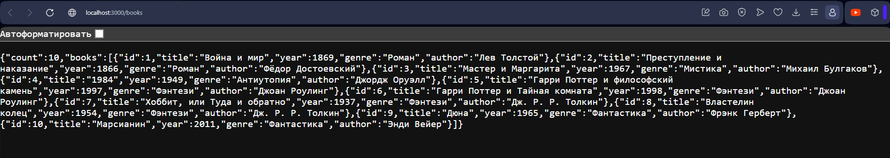

**GET Book by ID — GET /books/1**


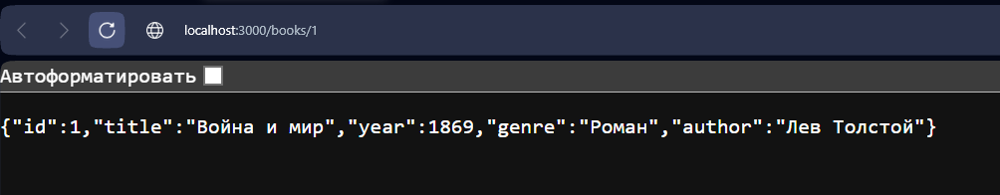


**GET Book Details — GET /books/1/details**

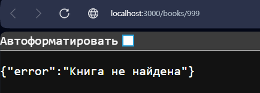


**GET Books by Genre — GET /genres/Фэнтези/books**


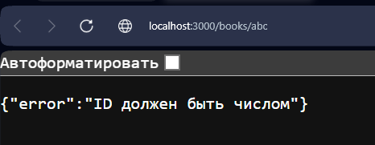

**GET Books Search — GET /books?search=Гарри**

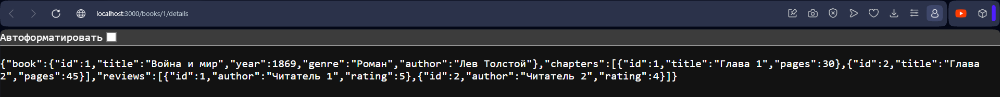

**GET Books Filter Genre — GET /books?genre=Фэнтези**

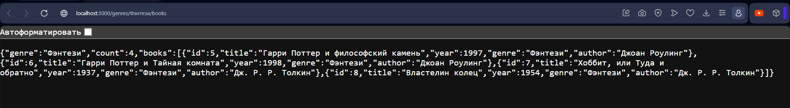

**GET Books Filter Year — GET /books?year=1949**

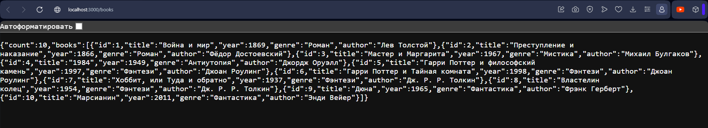


**GET Books Sort — GET /books?sort=year&order=desc**

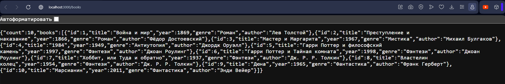


**GET Books Pagination — GET /books?page=1&limit=3**

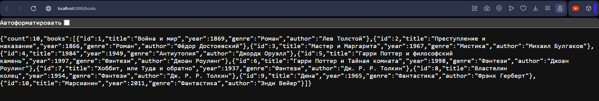


**Ошибка 404 — GET /books/999**

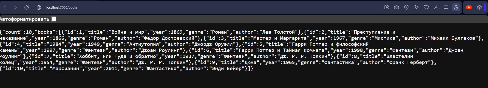

**Ошибка 400 (ID не число) — GET /books/abc**


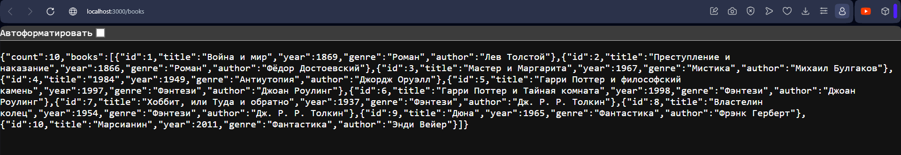


**Ошибка 400 (невалидная сортировка) — GET /books?sort=author**

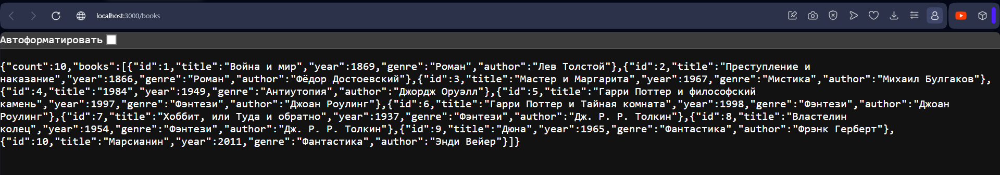


**Ошибка 400 (page < 1) — GET /books?page=0**

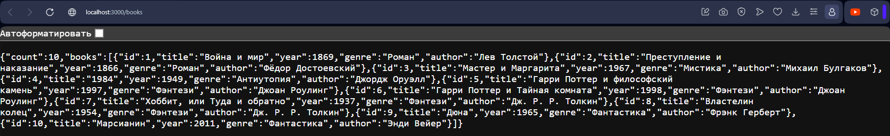


**Ошибка 400 (limit > 100) — GET /books?limit=200**

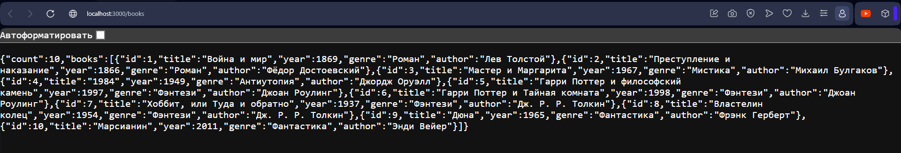


**Ошибка 404 (маршрут не найден) — GET /anything-else**

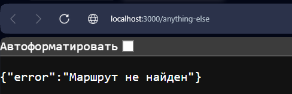

## Проверка через Postman

Для наглядной демонстрации запросов с параметрами также использовался Postman. Создана коллекция **Lab3 Routing Params API** с ключевыми запросами и автотестами. Проверка основного функционала выполнялась через браузер, так как все эндпоинты используют метод GET.

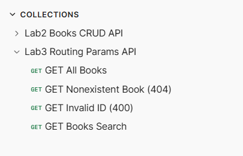
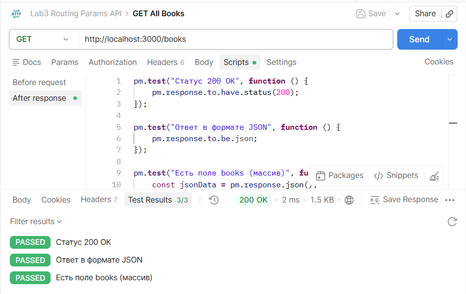
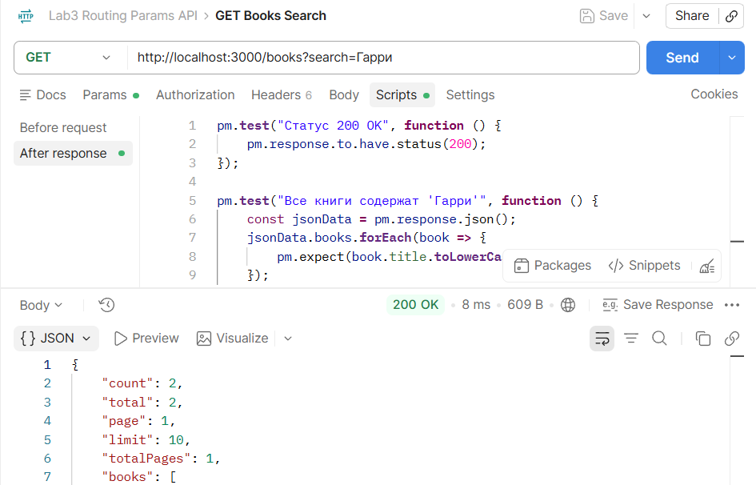
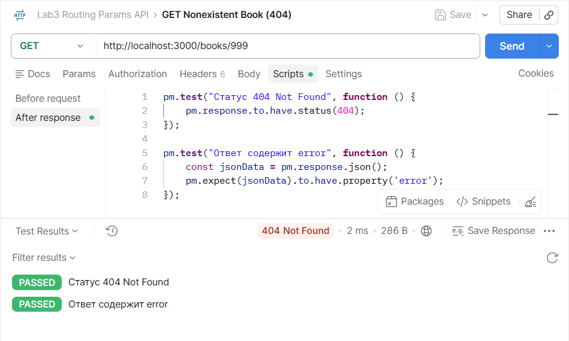
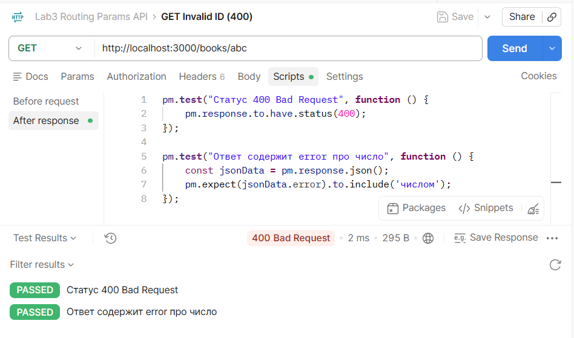
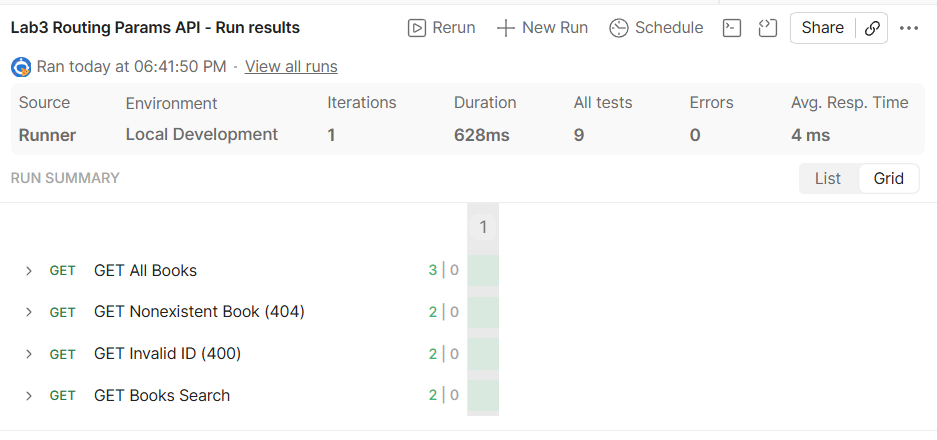


### Автотесты в Postman

**Пример тестов для GET All Books:**

```javascript
pm.test("Статус 200 OK", function () {
    pm.response.to.have.status(200);
});

pm.test("Ответ в формате JSON", function () {
    pm.response.to.be.json;
});

pm.test("Есть поле books (массив)", function () {
    const jsonData = pm.response.json();
    pm.expect(jsonData.books).to.be.an('array');
});
```

**Пример тестов для GET Books Search:**

```javascript
pm.test("Статус 200 OK", function () {
    pm.response.to.have.status(200);
});

pm.test("Все книги содержат 'Гарри'", function () {
    const jsonData = pm.response.json();
    jsonData.books.forEach(book => {
        pm.expect(book.title.toLowerCase()).to.include('гарри');
    });
});
```

**Пример тестов для GET Nonexistent Book (404):**

```javascript
pm.test("Статус 404 Not Found", function () {
    pm.response.to.have.status(404);
});

pm.test("Ответ содержит error", function () {
    const jsonData = pm.response.json();
    pm.expect(jsonData).to.have.property('error');
});
```

**Пример тестов для GET Invalid ID (400):**

```javascript
pm.test("Статус 400 Bad Request", function () {
    pm.response.to.have.status(400);
});

pm.test("Ответ содержит error про число", function () {
    const jsonData = pm.response.json();
    pm.expect(jsonData.error).to.include('числом');
});
```

## Контрольные вопросы

**1. Как получить query-параметры в Express/Flask? Чем они отличаются от параметров пути?**

Express:

```javascript
const search = req.query.search; // ?search=Гарри
const page = req.query.page;     // ?page=1
```

Flask:

```python
search = request.args.get('search')
page = request.args.get('page', type=int)
```

**Отличие:** параметры пути (`/books/:id`) — часть URL до `?`, идентифицируют ресурс. Query-параметры (`/books?search=...`) — после `?`, используются для фильтрации, сортировки, пагинации.

**2. Как задать значение по умолчанию для query-параметра?**

Express:

```javascript
const page = parseInt(req.query.page) || 1;
const limit = parseInt(req.query.limit) || 10;
```

Flask:

```python
page = request.args.get('page', 1, type=int)
limit = request.args.get('limit', 10, type=int)
```

**3. Как реализовать поиск по подстроке через query-параметр?**

Express:

```javascript
if (search) {
  const s = search.toLowerCase();
  result = result.filter(b => b.title.toLowerCase().includes(s));
}
```

**4. Как реализовать сортировку по нескольким полям?**

Сначала сортируем по второстепенному полю, потом по главному (стабильная сортировка):

```javascript
result.sort((a, b) => {
  if (a.secondary !== b.secondary) return a.secondary - b.secondary;
  return a.primary - b.primary;
});
```

**5. Как реализовать пагинацию с подсчётом общего количества страниц?**

```javascript
const total = result.length;
const totalPages = Math.ceil(total / limit);
const start = (page - 1) * limit;
const paginated = result.slice(start, start + limit);
res.json({ count: paginated.length, total, page, limit, totalPages, books: paginated });
```

**6. Как валидировать query-параметры? Какие коды ответов использовать?**

```javascript
const allowedSortFields = ['id', 'title', 'year'];
if (sort && !allowedSortFields.includes(sort)) {
  return res.status(400).json({ error: 'Невалидное поле сортировки' });
}
if (page < 1) return res.status(400).json({ error: 'page должен быть >= 1' });
if (limit < 1 || limit > 100) return res.status(400).json({ error: 'limit должен быть от 1 до 100' });
```

**Коды:** 400 — невалидные параметры, 404 — ресурс не найден, 200 — успех.

**7. Как реализовать фильтрацию по нескольким полям одновременно?**

Применяем фильтры последовательно:

```javascript
let result = [...books];
if (genre) result = result.filter(b => b.genre === genre);
if (year) result = result.filter(b => b.year === parseInt(year));
```

**8. Что произойдёт, если query-параметр передан несколько раз (?tag=js&tag=node)?**

Express: `req.query.tag` будет массивом `['js', 'node']`.  
Flask: `request.args.getlist('tag')` вернёт список.

**9. Как ограничить максимальное значение limit?**

```javascript
const limit = parseInt(req.query.limit) || 10;
if (limit < 1 || limit > 100) {
  return res.status(400).json({ error: 'limit должен быть от 1 до 100' });
}
```

Это защищает сервер от слишком больших выборок.

## Вывод

В ходе лабораторной работы я освоила различные способы передачи данных через URL: параметры пути, query-параметры и их комбинации. Научилась строить гибкие маршруты в Express, обрабатывать вложенные ресурсы и валидировать входные данные.

Для индивидуального задания (вариант 4, сущность «Книги») реализован REST-подобный API с полями `id`, `title`, `year`, `genre`, `author`. Реализованы:

- базовые эндпоинты: `/books`, `/books/:id`, `/books/:id/details`, `/genres/:genre/books`;
- поиск по названию (`?search=`);
- фильтрация по жанру и году (`?genre=`, `?year=`);
- сортировка по белому списку полей (`?sort=id|title|year&order=asc|desc`);
- пагинация с подсчётом общего количества страниц (`?page=&limit=`);
- валидация параметров (400) и обработка 404.

Основная трудность — порядок объявления маршрутов в Express: более специфичные маршруты (`/books/:id/details`) должны идти раньше общих (`/books/:id`), а маршрут `/books` с query-параметрами должен быть только один, иначе Express останавливается на первом совпавшем. Также потребовалось аккуратно приводить типы (все query-параметры — строки) и использовать белый список полей для сортировки, чтобы избежать ошибок.

Проверка выполнялась в браузере (все эндпоинты — GET) и в Postman (для наглядных скриншотов и автотестов). Все 15 эндпоинтов работают корректно, возвращают ожидаемые коды ответов.

## Список использованных источников

1. Express – Routing – https://expressjs.com/en/guide/routing.html
2. Express – Request и Response – https://expressjs.com/en/4x/api.html
3. Flask – Routing – https://flask.palletsprojects.com/en/latest/quickstart/#routing
4. Flask – Request – https://flask.palletsprojects.com/en/latest/api/#incoming-request-data
5. HTTP-методы (MDN) – https://developer.mozilla.org/ru/docs/Web/HTTP/Methods
6. URL-параметры (MDN) – https://developer.mozilla.org/ru/docs/Learn/Common_questions/What_is_a_URL
7. REST API Tutorial – https://restfulapi.net/
8. Postman Learning Center – https://learning.postman.com/
9. Методические указания к лабораторной работе №3.