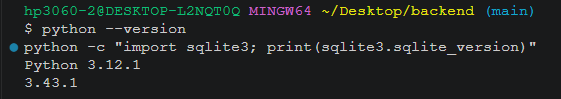
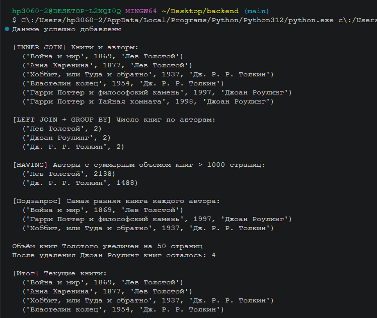
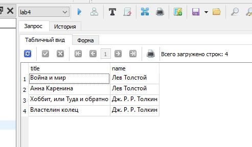

# Лабораторная работа №4

**Студент:** Алейникова Юлия Андреевна
**Группа:** ПИЖ-б-о-25-1
**Вариант:** 4 (средний уровень)
**Сущность:** Книги (books)
**Тема:** SQL и реляционная база данных SQLite
**СУБД:** SQLite
**Стек:** Python + sqlite3

---

## Цель работы

Освоить базовые операции SQL. Создать две связанные таблицы с внешним ключом, наполнить данными в транзакции, построить выборки с JOIN и группировкой, выполнить UPDATE и каскадное удаление. Сравнить хранение в памяти (ЛР №2–3) и в СУБД.


## Краткие теоретические сведения

**Реляционная модель.** Данные хранятся в таблицах. Строка – запись, столбец – поле с типом. Связь между таблицами – внешний ключ: колонка дочерней таблицы ссылается на первичный ключ родительской.

**SQLite.** Встраиваемая СУБД, хранящая всю базу в одном файле. Не требует сервера. Поддерживает JOIN, подзапросы, транзакции. Внешние ключи работают только после `PRAGMA foreign_keys = ON`.

**Классы команд:**

| Класс | Назначение | Примеры |
|-------|------------|---------|
| DDL | структура | `CREATE TABLE`, `DROP TABLE` |
| DML | данные | `INSERT`, `SELECT`, `UPDATE`, `DELETE` |
| TCL | транзакции | `BEGIN`, `COMMIT`, `ROLLBACK` |
| DCL | доступ | `GRANT`, `REVOKE` |

**Операторы в работе:**
- **JOIN** – соединение строк двух таблиц. `INNER` – только совпадения, `LEFT` – все строки левой таблицы.
- **GROUP BY** – группировка для агрегатов.
- **HAVING** – фильтр после группировки.
- **ON DELETE CASCADE** – удаление родителя удаляет дочерние.

---

## Схема базы данных

Связь «один ко многим»: один автор – много книг.

**authors**

| Колонка | Тип | Ограничения |
|---------|-----|-------------|
| id | INTEGER | PK AUTOINCREMENT |
| name | TEXT | NOT NULL, UNIQUE |
| country | TEXT | – |

**books**

| Колонка | Тип | Ограничения |
|---------|-----|-------------|
| id | INTEGER | PK AUTOINCREMENT |
| title | TEXT | NOT NULL |
| year | INTEGER | – |
| genre | TEXT | – |
| pages | INTEGER | – |
| author_id | INTEGER | NOT NULL, FK → authors(id) ON DELETE CASCADE |

Связь через `author_id`. `CASCADE` удаляет книги при удалении автора – это соответствует п. 1 требований.

---

## Ход работы

### Подготовка окружения

Модуль `sqlite3` входит в стандартную библиотеку Python, устанавливать ничего не нужно. Проверка версий:



Создана папка проекта:

```bash
mkdir lab4-sqlite-medium
cd lab4-sqlite-medium
mkdir screen
```
---

## Требования варианта 4 (средний уровень)

1. Создать две связанные таблицы с внешним ключом и правилом `ON DELETE CASCADE`.
2. Включить проверку внешних ключей через `PRAGMA foreign_keys = ON`.
3. Наполнить таблицы данными в рамках транзакции (`BEGIN` / `COMMIT` / `ROLLBACK`).
4. Выполнить выборки:
   - `INNER JOIN` – книги с авторами;
   - `LEFT JOIN` + `GROUP BY` – число книг по авторам;
   - `GROUP BY` + `HAVING` – авторы с суммарным объёмом книг более 1000 страниц;
   - коррелированный подзапрос – самая ранняя книга каждого автора.
5. Выполнить `UPDATE` с подзапросом.
6. Выполнить `DELETE` и проверить каскадное удаление связанных записей.

---

### Создание скрипта `db.py`

Файл `db.py` выполняет полный цикл: подключение, создание схемы, вставку в транзакции, выборки, обновление и удаление.

```python
import sqlite3

conn = sqlite3.connect('lab4.db')
conn.execute('PRAGMA foreign_keys = ON')
cur = conn.cursor()

# создание таблиц: автор и книга, связь через author_id
cur.executescript("""
CREATE TABLE IF NOT EXISTS authors (
    id      INTEGER PRIMARY KEY AUTOINCREMENT,
    name    TEXT NOT NULL UNIQUE,
    country TEXT
);

CREATE TABLE IF NOT EXISTS books (
    id        INTEGER PRIMARY KEY AUTOINCREMENT,
    title     TEXT NOT NULL,
    year      INTEGER,
    genre     TEXT,
    pages     INTEGER,
    author_id INTEGER NOT NULL,
    FOREIGN KEY (author_id) REFERENCES authors(id) ON DELETE CASCADE
);
""")

# очистка перед повторным запуском (сначала книги)
cur.execute('DELETE FROM books')
cur.execute('DELETE FROM authors')

# вставка данных в транзакции
try:
    cur.execute("INSERT INTO authors (name, country) VALUES (?, ?)", ('Лев Толстой', 'Россия'))
    tolstoy = cur.lastrowid
    cur.execute("INSERT INTO authors (name, country) VALUES (?, ?)", ('Джоан Роулинг', 'Великобритания'))
    rowling = cur.lastrowid
    cur.execute("INSERT INTO authors (name, country) VALUES (?, ?)", ('Дж. Р. Р. Толкин', 'Великобритания'))
    tolkien = cur.lastrowid

    # книги одной пачкой
    cur.executemany(
        "INSERT INTO books (title, year, genre, pages, author_id) VALUES (?, ?, ?, ?, ?)",
        [
            ('Война и мир',                        1869, 'Роман',      1274, tolstoy),
            ('Анна Каренина',                      1877, 'Роман',       864, tolstoy),
            ('Гарри Поттер и философский камень',  1997, 'Фэнтези',     332, rowling),
            ('Гарри Поттер и Тайная комната',      1998, 'Фэнтези',     416, rowling),
            ('Хоббит, или Туда и обратно',         1937, 'Фэнтези',     310, tolkien),
            ('Властелин колец',                    1954, 'Фэнтези',    1178, tolkien),
        ]
    )
    conn.commit()
    print('Данные успешно добавлены')
except Exception as err:
    # откат при ошибке
    conn.rollback()
    print('Откат транзакции:', err)

# INNER JOIN: книги с авторами
print('\n[INNER JOIN] Книги и авторы:')
cur.execute("""
    SELECT b.title, b.year, a.name
    FROM books b
    JOIN authors a ON a.id = b.author_id
    ORDER BY b.year
""")
for row in cur.fetchall():
    print(' ', row)

print('\n[LEFT JOIN + GROUP BY] Число книг по авторам:')
cur.execute("""
    SELECT a.name, COUNT(b.id)
    FROM authors a
    LEFT JOIN books b ON b.author_id = a.id
    GROUP BY a.id
""")
for row in cur.fetchall():
    print(' ', row)

print('\n[HAVING] Авторы с суммарным объёмом книг > 1000 страниц:')
cur.execute("""
    SELECT a.name, SUM(b.pages)
    FROM authors a
    JOIN books b ON b.author_id = a.id
    GROUP BY a.id
    HAVING SUM(b.pages) > 1000
""")
for row in cur.fetchall():
    print(' ', row)

print('\n[Подзапрос] Самая ранняя книга каждого автора:')
cur.execute("""
    SELECT b.title, b.year, a.name
    FROM books b
    JOIN authors a ON a.id = b.author_id
    WHERE b.year = (
        SELECT MIN(year) FROM books WHERE author_id = b.author_id
    )
""")
for row in cur.fetchall():
    print(' ', row)

cur.execute("""
    UPDATE books
    SET pages = pages + 50
    WHERE author_id = (SELECT id FROM authors WHERE name = 'Лев Толстой')
""")
conn.commit()
print('\nОбъём книг Толстого увеличен на 50 страниц')

cur.execute("DELETE FROM authors WHERE name = 'Джоан Роулинг'")
conn.commit()
cur.execute('SELECT COUNT(*) FROM books')
print('После удаления Джоан Роулинг книг осталось:', cur.fetchone()[0])

print('\n[Итог] Текущие книги:')
cur.execute("""
    SELECT b.title, b.year, a.name
    FROM books b
    JOIN authors a ON a.id = b.author_id
    ORDER BY b.year
""")
for row in cur.fetchall():
    print(' ', row)

conn.close()
```

### 5.3. Запуск скрипта

```bash
python db.py
```

Вывод:



По выводу видно, что каждый пункт требований выполнен: JOIN дал книги с авторами, LEFT JOIN + GROUP BY посчитал книги по авторам, HAVING отфильтровал авторов с объёмом > 1000 страниц, подзапрос вернул самые ранние книги, UPDATE увеличил объём книг Толстого, DELETE каскадно удалил книги Роулинг.

### Проверка через SQL-клиент

Для визуальной проверки данных была открыта база `lab4.db` в программе SQLite Studio. Выполнен запрос на объединение таблиц:

```sql
SELECT b.title, a.name 
FROM books b 
JOIN authors a ON a.id = b.author_id;
```


В результатах запроса отображаются 4 оставшиеся книги, что подтверждает успешное выполнение каскадного удаления. Файл `lab4.db` сохраняется между запусками – это отличие от массивов в памяти (ЛР №2–3).

---


## Разбор запросов

**INNER JOIN.** Соединение книг с авторами по `author_id = id`. Книги без автора (если бы были) отбрасываются.

**LEFT JOIN + GROUP BY.** Все авторы остаются, даже без книг (`COUNT` даёт 0). Группировка по `a.id`.

**HAVING.** Фильтр после группировки по `SUM(pages)`. В `WHERE` агрегаты нельзя.

**Подзапрос.** Для каждой книги – минимум года среди книг того же автора. Коррелированный подзапрос ссылается на `b.author_id`.

**Транзакция.** Вставка в `try/commit/rollback`: при ошибке откат к исходному состоянию.

**CASCADE.** `DELETE FROM authors WHERE name = 'Джоан Роулинг'` удаляет её книги. Без `PRAGMA foreign_keys = ON` правило не работает.

---

## Контрольные вопросы

**INNER vs LEFT JOIN?**
`INNER` – только совпадения в обеих таблицах. `LEFT` – все строки левой, несовпавшие поля правой = `NULL`.

**Зачем `PRAGMA foreign_keys = ON`?**
В SQLite проверка внешних ключей по умолчанию выключена. Без директивы `FOREIGN KEY` и `CASCADE` игнорируются.

**Что делает `ON DELETE CASCADE`?**
Удаление родителя автоматически удаляет дочерние записи.

**WHERE vs HAVING?**
`WHERE` фильтрует строки до группировки, `HAVING` – группы после `GROUP BY`. В `HAVING` допустимы агрегаты.

**Зачем транзакции?**
Атомарность: либо все операции, либо ни одной. При ошибке `ROLLBACK` возвращает исходное состояние.

**Чем БД отличается от памяти?**
Память очищается при выходе из программы. БД в файле переживает перезапуск, поддерживает связи и ограничения, запросы декларативные.

**Что при вставке книги с несуществующим `author_id`?**
При включённом `PRAGMA` – ошибка `FOREIGN KEY constraint failed`, вставка не проходит.

---

## Вывод

В ходе работы выполнены все требования варианта 4 среднего уровня (сущность «Книги»): созданы две связанные таблицы `authors` и `books` с внешним ключом и каскадным удалением, включена проверка внешних ключей, данные вставлены в транзакции, построены выборки с `INNER JOIN`, `LEFT JOIN` + `GROUP BY`, `HAVING` и коррелированным подзапросом, выполнены `UPDATE` с подзапросом и `DELETE` с проверкой каскада. 